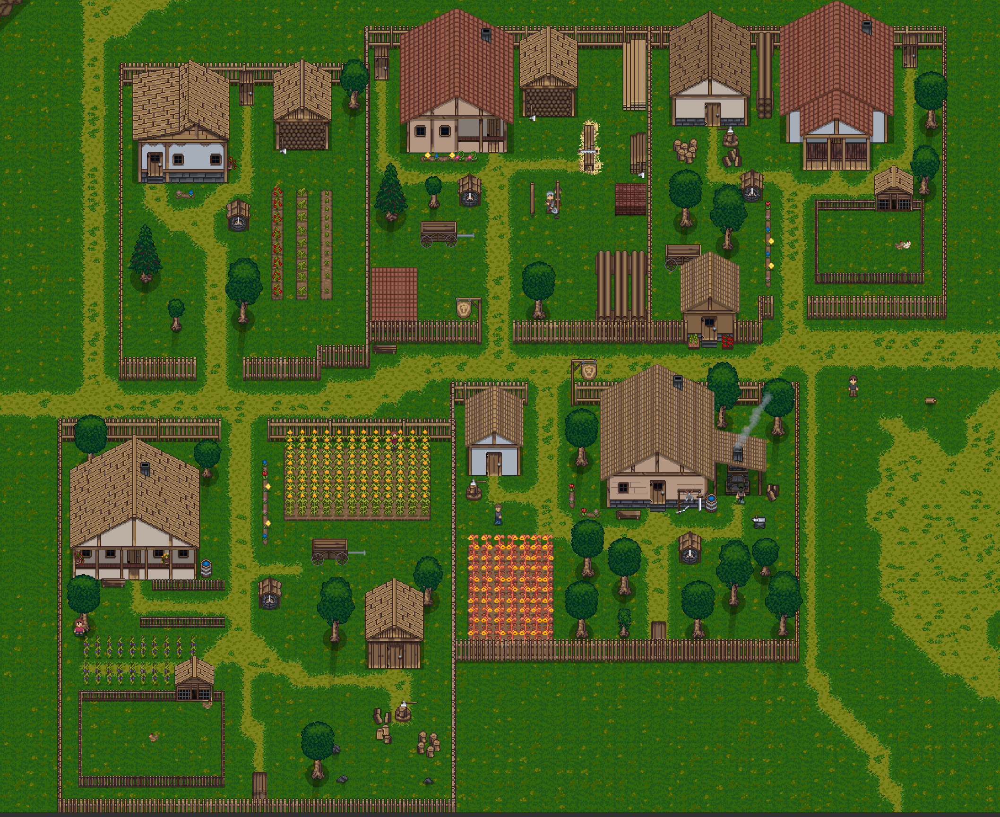
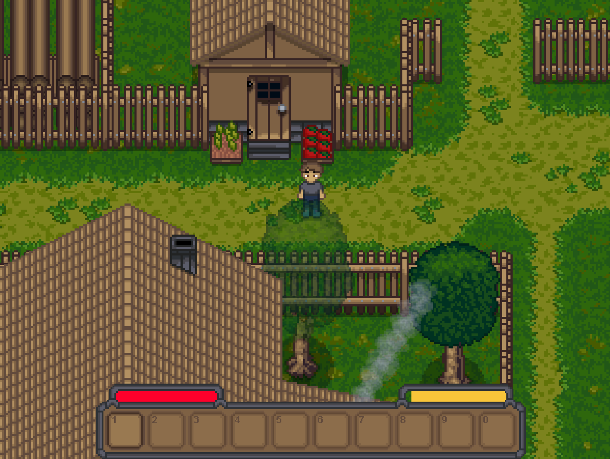
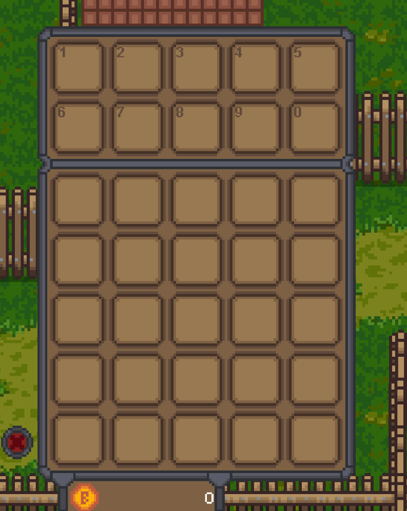
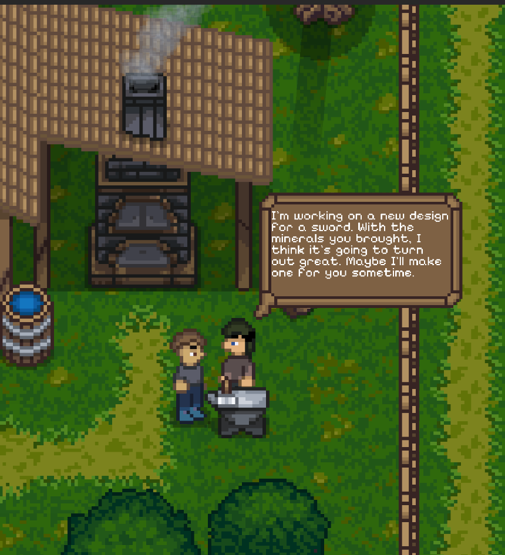
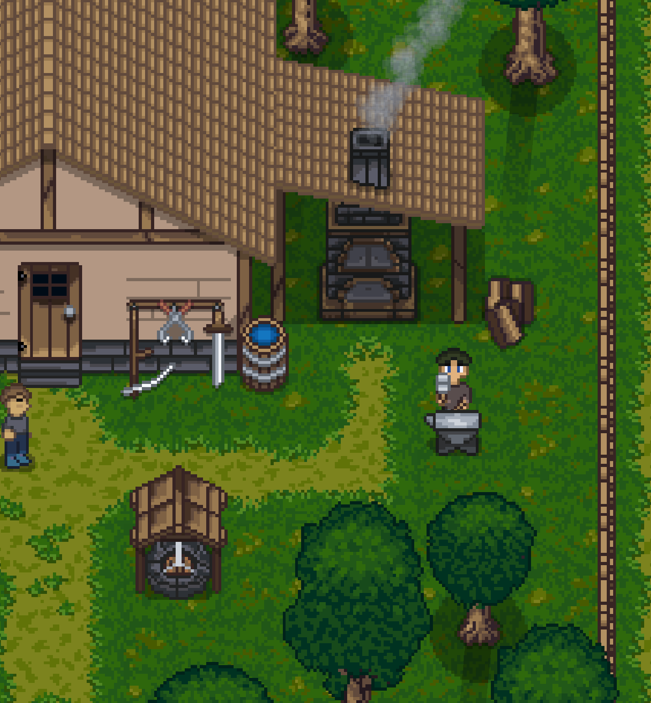
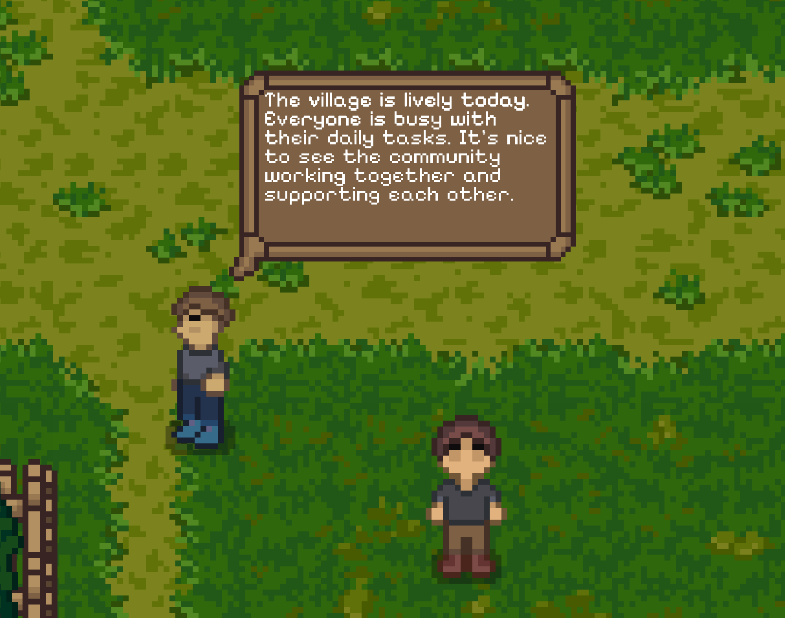

# Ecspel

**Ecspel** is a 2D farming and adventure RPG built with Unity, inspired by Stardew Valley. Experience a rich farming simulation combined with exploration, combat, quests, and a deep story in a handcrafted pixel art world.



## Tech Stack


## Features

### Core Gameplay Systems

- **Farming & Agriculture**
  - Grid-based farming system with soil tilling and watering mechanics
  - Crop planting, growth, and harvesting with multiple growth stages
  - Seasonal crop rotation and plant lifecycle management
  - Watering can, hoe, and other farming tools
  - Farm plot management with customizable layouts

- **Resource Gathering**
  - Tree chopping with axe tools and dynamic damage system
  - Stone breaking with pickaxe mechanics
  - Collectable resources scattered throughout the world
  - Resource spawning and regeneration in designated areas

- **Building & Construction**
  - Placeable objects and structures on a grid-based system
  - Fence system with smart placement and rotation
  - Interactive buildings (chicken coops, forges, etc.)
  - Customizable farm layouts

- **Crafting & Forging**
  - Comprehensive crafting system with recipes
  - Recipe unlocking and discovery system
  - Forge mechanics for tool and equipment creation
  - Material requirements and item combining

- **Inventory Management**
  - Full inventory system with drag-and-drop functionality
  - Quick slots for fast item access
  - Chest storage system with persistent data
  - Item stacking and organization
  - Bin/trash system for unwanted items

- **Quest System**
  - Dynamic quest tracking with multiple objective types:
    - Go to location objectives
    - Talk to NPC objectives
    - Give item objectives
  - Quest rewards (items, coins, experience)
  - Quest log with detailed information
  - World markers for quest objectives

- **Dialogue & NPCs**
  - Rich dialogue system with multiple NPCs
  - Dialogue trees with player choices and responses
  - Dynamic dialogue changes based on game progression
  - Character relationships and story progression
  - Named NPCs: Bob, Andrei, Ana, Maria, Mihaela, Marilena, Valentin, Victoria, and more

- **Combat System**
  - Player combat with weapon mechanics
  - Enemy AI with pathfinding (Skeleton, Eye, Giant Eye, Spitter)
  - Enemy spawning and wave systems
  - Player health and death mechanics
  - Projectile-based attacks

- **Animals & Wildlife**
  - Birds (chickens, ducks, swans) with AI behavior
  - Fish spawning and AI in water areas
  - Animal pathfinding and natural behaviors
  - Day/night cycle affecting animal behavior
  - Chicken coop management

- **Skills & Progression**
  - Skill system with multiple skill trees
  - Skill leveling and power upgrades
  - Player stats (stamina, health, speed)
  - Fatigue and slow effect mechanics
  - Experience and level progression

- **Shop & Economy**
  - Currency system (coins)
  - Shop interface for buying and selling items
  - Item pricing and value system
  - Economic progression

### World & Environment

- **Day/Night Cycle**
  - Dynamic time system with day/night transitions
  - End-of-day events and save system
  - Time-based NPC schedules
  - Speed up time mechanic

- **Dynamic Lighting**
  - Campfire lighting system
  - Environmental lighting effects
  - Shadow rendering for objects

- **Weather & Atmosphere**
  - Wind effects and particle systems
  - Visual atmosphere and ambiance
  - Environmental storytelling

- **Multiple Locations**
  - Diverse areas to explore (caves, forests, villages)
  - Location-based grid systems
  - Teleportation and waypoint system
  - Scene transitions with fade effects

### UI & User Experience

- **Comprehensive UI System**
  - Tab menu system with multiple panels
  - Inventory UI with item details
  - Crafting interface
  - Quest log and tracker
  - Skills menu
  - Pause menu

- **Visual Feedback**
  - Item pickup animations
  - Particle effects for actions
  - Hover tooltips and item details
  - Visual indicators for interactable objects

- **Audio**
  - Sound effects for actions (chopping, mining, item pickup)
  - Background music system
  - Ambient sounds

### Technical Features

- **Save System**
  - Comprehensive save/load functionality
  - Persistent world state
  - Grid state serialization
  - NPC and quest progress saving
  - Inventory and chest data persistence

- **Procedural Systems**
  - Object spawning in designated areas
  - Resource regeneration
  - Dynamic enemy spawning

- **Event System**
  - Area enter/exit events
  - End-of-day events
  - Story-driven triggers
  - Special event handlers (flower pillars, campfires)

## Handcrafted Art

All sprites and artwork in Ecspel are **100% hand-made**, including:
- Character sprites and animations
- NPC designs
- Enemy designs
- Environmental tiles and objects
- UI elements
- Item icons
- Building and structure graphics

## Screenshots

### Player Character with Stats
View your character's health, stamina, and equipment in real-time.



### Inventory System
A comprehensive inventory system with drag-and-drop functionality, item details, and quick slots.



### NPC Dialogue
Engage in rich conversations with NPCs featuring dialogue trees and player choices.



### NPC Daily Routines
NPCs follow realistic daily schedules, moving between locations throughout the day.



### Player Monologue
Story-driven internal monologues guide the player through the narrative.



## Game Controls

- **WASD** - Character movement
- **Left Shift** - Run (consumes stamina)
- **Left Mouse** - Use tool / Interact / Place object
- **Tab** - Open inventory/menu
- **R** - Rotate placeable objects (fences, etc.)
- **Escape** - Pause menu

## Project Structure

```
Ecspel/
├── Assets/
│   ├── Animals/          (Bird AI, Fish AI, pathfinding)
│   ├── Build system/     (Farming, construction, resource gathering)
│   ├── Building/         (Interactive buildings)
│   ├── Chest/            (Storage system)
│   ├── Crafting/         (Crafting mechanics and UI)
│   ├── Dialogue/         (Dialogue system and NPC conversations)
│   ├── Enemy/            (Enemy AI and combat)
│   ├── Environment/      (World objects and terrain)
│   ├── Forge/            (Forging system)
│   ├── Items/            (Item definitions and behaviors)
│   ├── Light/            (Lighting effects)
│   ├── Menu/             (Main menu and UI)
│   ├── Mobs/             (Mobile entities)
│   ├── NPC's/            (NPC characters and behavior)
│   ├── Objects/          (World objects)
│   ├── Plants/           (Crop and plant systems)
│   ├── Player/           (Player controller and stats)
│   ├── Quests/           (Quest system)
│   ├── SaveGame/         (Save/load functionality)
│   ├── Scenes/           (Game scenes)
│   ├── Shop/             (Economy and trading)
│   ├── Skills/           (Skill system)
│   ├── Sounds/           (Audio files)
│   ├── Sprites/          (All hand-drawn artwork)
│   ├── Story/            (Story events and triggers)
│   └── UI/               (User interface elements)
├── ProjectSettings/      (Unity project configuration)
└── Ecspel.sln           (Visual Studio solution)
```

## Requirements

- **Unity 2022** or higher
- **Visual Studio** (for C# development)
- **Unity 2D packages:**
  - Unity 2D Animation
  - Unity 2D Tilemap Extras
  - TextMesh Pro
- **Input System** package

## Getting Started

### 1. Clone the Repository

```bash
git clone https://github.com/severmanolescu/Ecspel.git
```

### 2. Open in Unity

1. Open Unity Hub
2. Click "Open" and select the Ecspel folder
3. Unity will import all assets and compile scripts (this may take a few minutes)

### 3. Install Required Packages

Unity should automatically install required packages. If not:
1. Go to **Window > Package Manager**
2. Install:
   - Unity 2D Animation
   - Unity 2D Tilemap Extras
   - Input System
   - TextMesh Pro

### 4. Build and Run

1. Open the main scene from `Assets/Scenes/`
2. Click the Play button in Unity Editor to test
3. For builds: **File > Build Settings** and select your target platform

## Development Highlights

Based on recent commits, the game includes:
- Multiple NPCs with unique personalities and dialogue trees
- Extensive cave system with mining mechanics
- Builder and blacksmith NPCs with specialized functions
- Event-driven story progression
- Detailed interior spaces for character houses
- Trigger-based world events

## Story

Ecspel features a rich narrative with:
- Character-driven storylines
- Relationship building with NPCs
- Discovery of special locations (flower pillars, magical caves)
- Progressive unlocking of game areas
- Endgame content and finale events 

## Credits

- **Developer & Artist**: Sever Manolescu
- **All sprites and artwork**: Hand-drawn by Sever Manolescu
- **Engine**: Unity
- **Programming Language**: C#

## License

This project is proprietary. All rights reserved.
